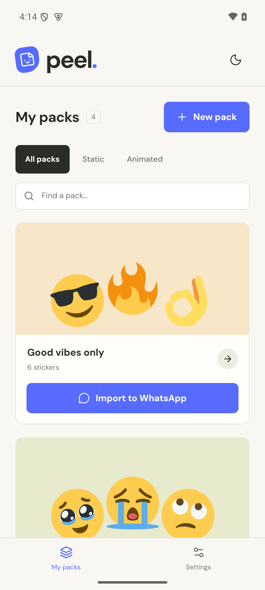
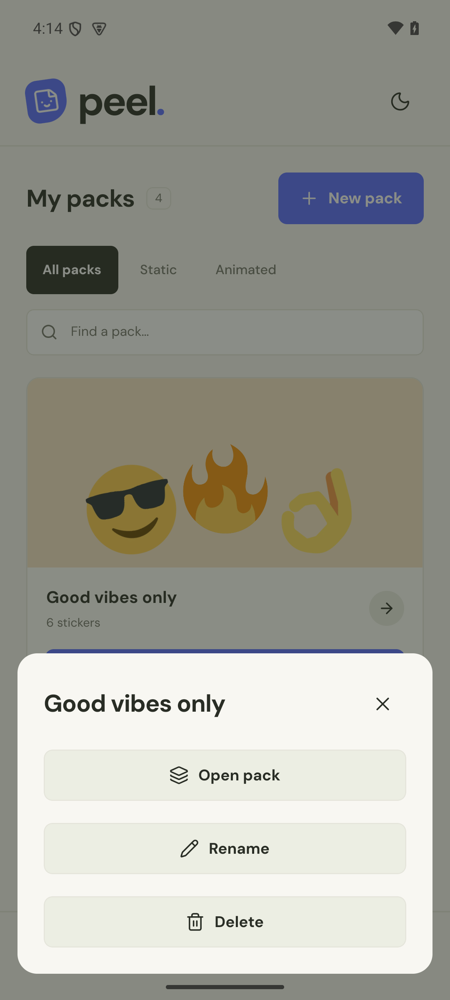
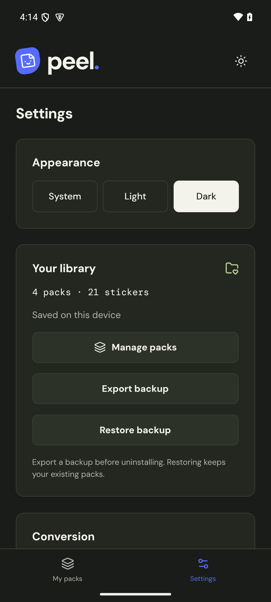

# Peel

Turn photos, GIFs, animated WebP, and short videos into WhatsApp sticker packs. Android conversion runs on your phone, with no account or upload required.

[Download APK](https://github.com/aaditagrawal/peel/releases/latest) · [Add to Obtainium](https://apps.obtainium.imranr.dev/redirect?r=obtainium://add/https://github.com/aaditagrawal/peel)

<p>
  
  
  
</p>

## Use

Create a pack, choose photos or GIFs, or trim a video to 1–6 seconds. Name your stickers, then tap **Import to WhatsApp** and confirm in WhatsApp. Hold a pack to open, rename, or delete it.

- Original image selection, transparent backgrounds, and automatic fitting to WhatsApp's size limits.
- Separate static and animated packs, with 3–30 stickers per import. Smaller packs remain drafts.
- Large and mixed selections split into compatible packs automatically.
- Light, dark, or system appearance. DM Sans and DM Mono typography.
- Settings → Export backup saves your packs to a folder you choose. Restore backup merges them without replacing existing packs.

Photos and GIFs can be up to 50 MB; videos up to 100 MB. GIFs and animated WebP must be no longer than 10 seconds. Android codec support determines which HEIC, HEIF, AVIF, and video files open. Detailed clips may lose some detail or frame rate to fit WhatsApp's limits. Peel preserves the original file and does not remove backgrounds.

## Install and update

Download the APK from [GitHub Releases](https://github.com/aaditagrawal/peel/releases). Android may ask you to allow installation from your browser or file manager.

For updates, add `https://github.com/aaditagrawal/peel` in [Obtainium](https://github.com/ImranR98/Obtainium). Stable releases contain one APK for arm64 phones and x86_64 emulators. Keep prereleases disabled for normal use. No Play Store or Expo Go is required.

Package: `app.peel.stickers`. Each release includes APK checksums and its signing certificate fingerprint. Updates use the same production signing key and preserve your library.

Production certificate SHA-256: `73f6873772c4d869c4219d7b828221a43c6cb11213c8518f01d2c22b3525a2aa`.

### Moving from an early test build

The early Taildrop builds used a development signing key. They cannot be directly replaced by the production-signed app.

1. Install the 1.0.8 migration build supplied alongside your test installation.
2. In Settings, export a backup to a folder outside Peel. Confirm that the JSON file is present.
3. Only after exporting, uninstall the test build and install the public release.
4. In Settings, restore the backup. Re-import packs into WhatsApp if needed.

Uninstalling Peel removes its local library. Backups contain your sticker images and names; keep them somewhere private.

## Development

Requires Node 24, Bun 1.4.3, and FFmpeg with WebP support for the web converter and tests.

```sh
bun install --frozen-lockfile
bun run dev
```

The web preview uses port 8081 and its converter uses 4311. `.env.example` lists optional configuration. Set `ALLOWED_ORIGINS` explicitly when accessing the web converter from another host. Android release builds convert offline; the web preview uploads files to the converter.

```sh
bun run lint
bun run typecheck
bun run test
```

The app uses Expo SDK 57 and a local Kotlin/C++ module with bundled libwebp. Generated `android/` and `ios/` folders are excluded. Change native configuration through Expo config plugins.

Android is the supported release target. The repository includes web preview and an experimental iOS bridge; iOS releases and device behavior have not been verified.

## Build and release

Install JDK 21, Android SDK 36, build-tools 36.0.0, and NDK 27.1.12297006. Set `JAVA_HOME` and `ANDROID_HOME`.

Production builds require a private signing key. Never commit it or its passwords. The release script checks the version, package ID, and signing certificate before accepting an APK.

```sh
bun run release:check
bun run build:apk
```

Provide `PEEL_KEYSTORE_PATH`, `PEEL_KEYSTORE_PASSWORD`, `PEEL_KEY_ALIAS`, `PEEL_KEY_PASSWORD`, and `PEEL_SIGNING_CERT_SHA256` through your environment. The expected fingerprint contains hex characters without colons. Building locally does not publish anything.

GitHub Actions runs checks on pushes and pull requests. To release, update `package.json` and `app.json` to the same version, increase `expo.android.versionCode`, and push a matching `v` tag. Release candidates use a suffix such as `1.1.0-rc.1`. Never reuse a published version code or tag.

The release workflow needs repository secrets `ANDROID_KEYSTORE_BASE64`, `ANDROID_KEYSTORE_PASSWORD`, `ANDROID_KEY_ALIAS`, and `ANDROID_KEY_PASSWORD`, plus the public repository variable `ANDROID_SIGNING_CERT_SHA256`. Keep an independent backup of the signing key; losing it prevents future updates with that identity.

Native conversion tests live in the local module's `androidTest` source set. `scripts/test-whatsapp-handoff/` is an emulator-only protocol fixture, not WhatsApp. Never install that fixture on a personal phone. Actual import confirmation and rendering still require a device with WhatsApp installed.

## Privacy and licenses

Android converts on-device. Peel has no analytics, account, or cloud sync. The optional web converter processes uploads in memory or temporary files and removes temporary video files after processing. Exported WhatsApp assets remain in Peel's private storage so WhatsApp can read them.

Peel is MIT licensed. Starter artwork is Twemoji under CC BY 4.0; fonts and libwebp have their own licenses. See [third-party notices](THIRD_PARTY_NOTICES.md). Peel is independent of WhatsApp and Meta.
